# Filament Slots and Sync: user guide

The CORE One INDX can remember the vendor and color of the filament in each tool, and PrusaSlicer
can read them over PrusaLink and pick matching filament presets for you.

You need:

- **Printer:** a CORE One INDX with firmware **v6.9.2-hy.3** or later from
  [hyiger/Prusa-Firmware-Buddy](https://github.com/hyiger/Prusa-Firmware-Buddy/releases), which has
  Filament Slots. Stock Prusa firmware doesn't report the filaments, and the CORE One L INDX isn't
  supported yet.
- **Slicer:** **PrusaSlicer 2.9.6 Filament Edition 1.16.0** or later from
  [hyiger/PrusaSlicer](https://github.com/hyiger/PrusaSlicer/releases).

## On the printer

### Load a filament and say what it is

**Filament > Load Filament** (and **Change Filament**, and autoload) asks for the type, then the
vendor, then the color. They're saved once the load succeeds. After an unload, the tool remembers
them, so the next load starts at the same vendor and color.

| Vendor | Color |
|---|---|
| 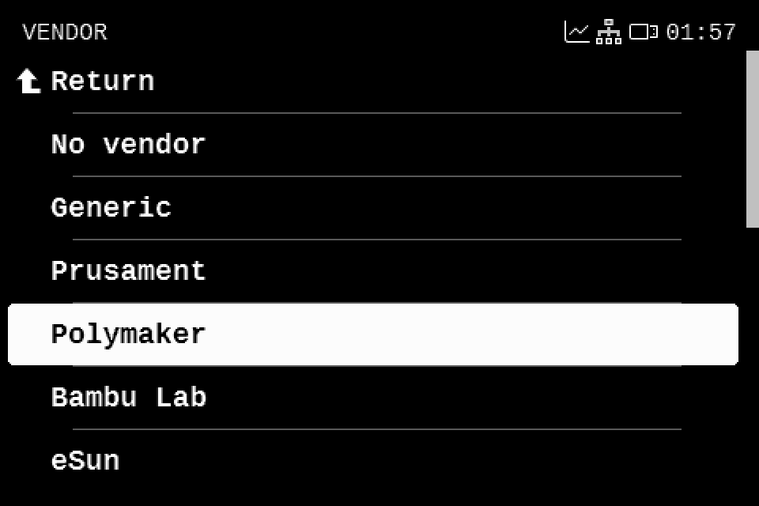 | 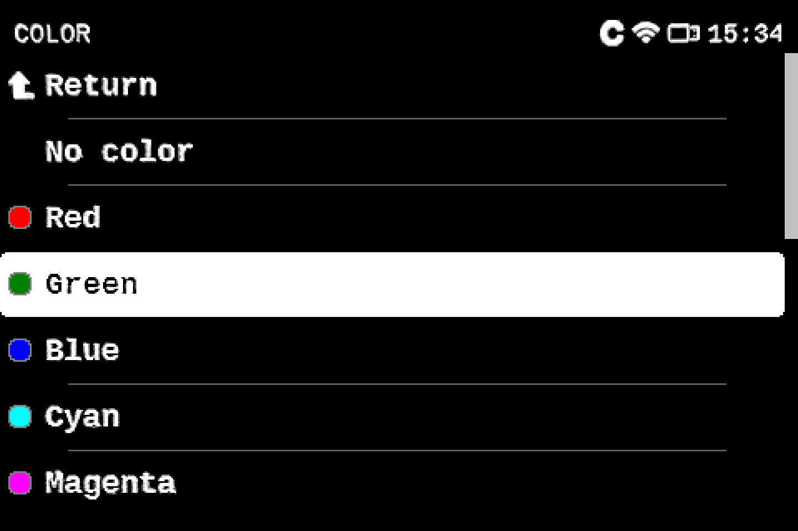 |

### Load every tool at once

**Filament > Load All** opens **Set All To**, which asks for the type and vendor once, then for the
color of each tool. **Don't load** at the top of a tool's color list leaves that tool out.
**Change All** opens the list of tools first: pick **Set All To** there for the same steps, or pick
a tool's row to set only that tool's type, vendor and color. The tool rows show the picked colors;
**Carry Out the Changes** loads them.

| Set All To | A tool's color, with Don't load |
|---|---|
| 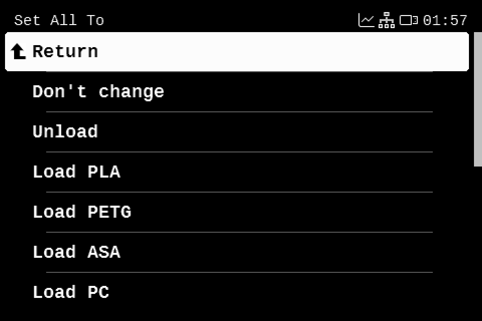 | 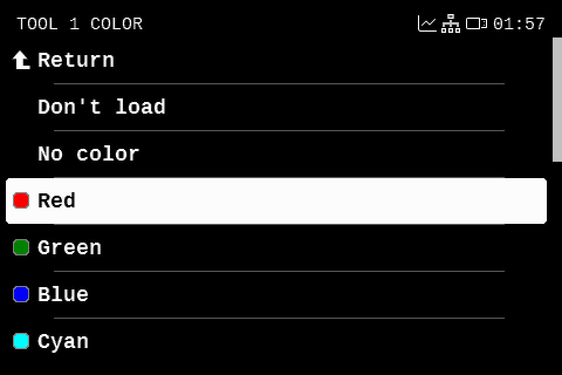 |

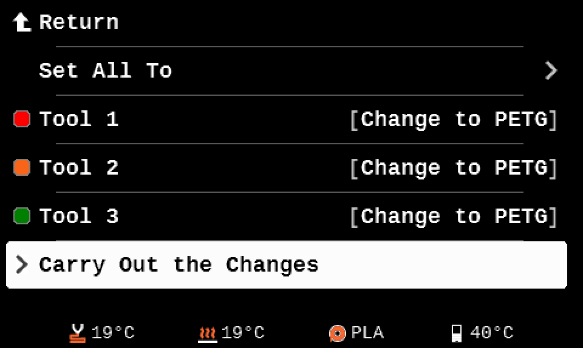

### See and correct what's in each tool

**Filament > Filament Slots** lists every tool with the vendor, type and color of its filament.
Open a tool to correct its vendor, type or color without reloading anything.

| Filament Slots on an INDX | One tool |
|---|---|
| 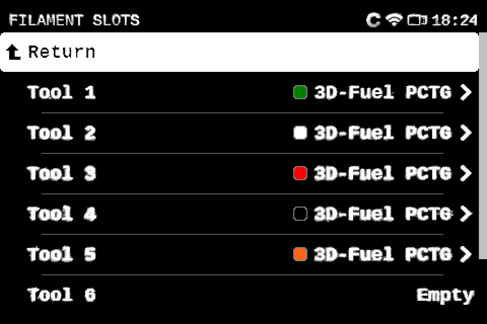 | 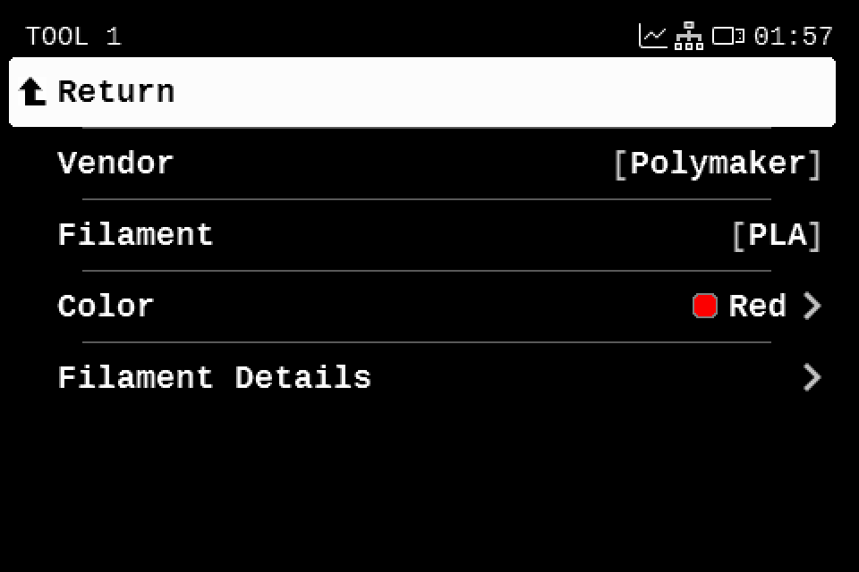 |

### Your own vendors and colors

There are 16 preset vendors and 16 preset colors, plus 8 user slots of each. **Filament > Manage
Filaments** has **Edit Vendors** and **Edit Colors** to name the user slots (and set a user color's
hex code), and **Enable Vendors** and **Enable Colors** to choose what the lists show.

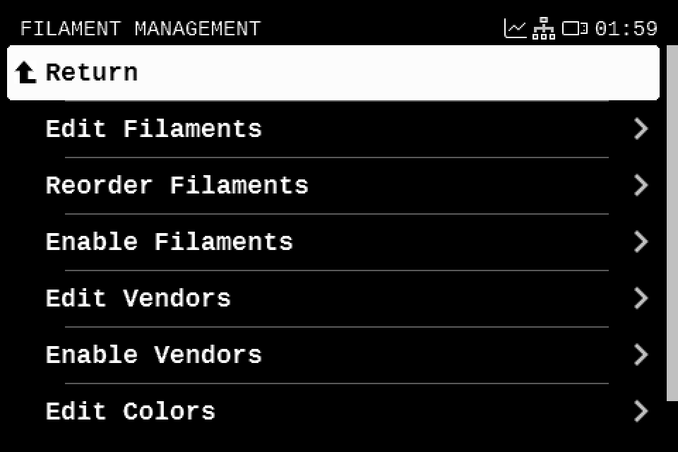

## In PrusaSlicer

### Connect PrusaSlicer to the printer

Add a physical printer for your INDX printer profile: the cog icon next to the Printer list,
**Add physical printer**. Set the host type to **PrusaLink**, the printer's address, and its API key
or user and password, then select it in the Printer list. The sync button (two circular arrows)
appears next to **Filament:** in the sidebar.

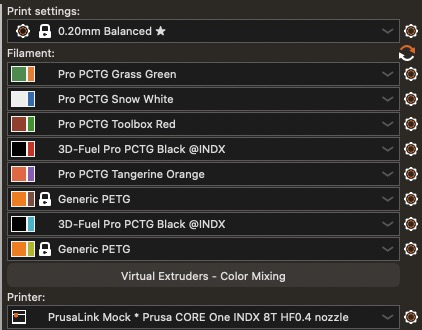

### Sync

Click the sync button, or choose **Maintenance > Sync Filaments from Printer…**. PrusaSlicer reads
the printer and shows a preview. Presets and extruder colors don't change until you click
**Apply**, but the sidebar hides the empty tools' filament lists as soon as the printer is read.
Tool N is always extruder N.

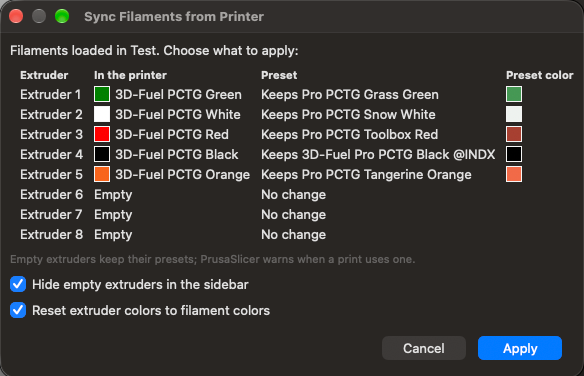

The **Preset** column says what Apply does for each extruder:

- **Keeps**: the selected preset already matches.
- **Selects**: picks the installed preset that fits best.
- **Installs and selects**: picks a matching system preset you haven't installed yet.
- **Creates … from …**: makes a new preset (below).
- **No change**: the tool is empty, so the extruder keeps its preset.
- **No preset to select**: no preset of that material fits the extruder and none could be made. A
  note says why, and the extruder keeps its preset.

Each loaded tool's **Preset** is a list with the suggestion first. Pick something else from it to
override the suggestion: a new preset in the tool's color, another preset of that material, or
keeping the extruder's preset.

### New colors get their own preset

When the printer names a vendor and no preset of that vendor and material fits, or only ones named
for another color do, PrusaSlicer creates one named `<vendor> <material> <color>`, such as
`Overture PETG Green`. A preset with no color in its name, such as `Overture PETG`, counts as a fit
and is selected instead, unless it's one of your own presets whose filament color is clearly
another: for a white spool, `PolyLite PLA Teal` is another color. The new preset is a copy of the extruder's current preset when that preset
is the same material, so your settings carry over; otherwise it starts from another preset of that
material, Generic first. Either way it gets the printer's vendor and color. New presets are saved
as user presets on this computer; they aren't added to Filament DB.

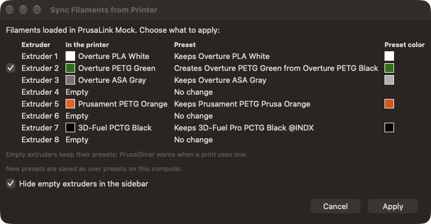

### After syncing

- **Extruder colors.** With **Reset extruder colors to filament colors** ticked (it's offered when an
  extruder has its own color), every extruder shows its filament's color. Save the printer preset to
  keep that.
- **Empty tools.** The filament lists of empty tools (and of docks that aren't calibrated) are
  hidden, and the rest are numbered. Untick **Hide empty extruders in the sidebar** in the preview
  to show them all. If a print uses an empty extruder, PrusaSlicer warns you.

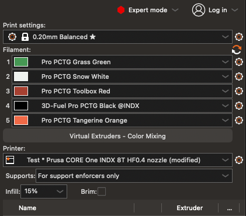

## Good to know

- Syncing is one way: nothing is written to the printer or to Filament DB.
- The printer can't tell plain, matte, silk or carbon fiber apart, so a selected variant preset that
  fits as well as the best one is kept.
- On printer firmware v6.9.2-hy.3, the tool mapping screen takes the G-code tools' colors from the
  extruder colors in the G-code; the printer's tools show their Filament Slots colors. After the
  color reset the G-code's extruder colors are empty, so its tools show no colors there.
- Full details: [Filament Sync Guide](Filament_Sync_Guide.md)
  and the [firmware release notes](https://github.com/hyiger/Prusa-Firmware-Buddy/releases).
